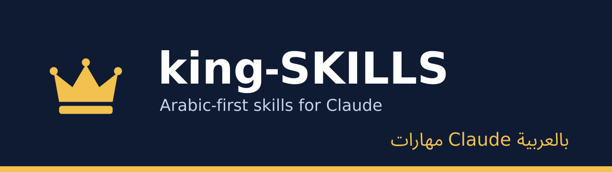

<div align="center">

**العربية** | [English](README.en.md)




</div>

# king-SKILLS

مكتبة مهارات (Skills) لـ Claude باللغة العربية في الكتابة والتصميم وهندسة البرمجيات، مع مسارات عمل إنتاجية إنجليزية أولاً. كل مهارة ملف `SKILL.md` يخبر Claude كيف ينفّذ مهمة بعينها خطوة بخطوة، مع شرح للمستخدم ومثال كامل.

## الفئات

| الفئة | الحزمة | عدد المهارات |
|---|---|---|
| [الكتابة والترجمة](#الكتابة-والترجمة) | `king-writing` | 5 |
| [الإنتاجية والتحليل](#الإنتاجية-والتحليل) | `king-productivity` | 4 |
| [التصميم](#التصميم) | `king-design` | 10 |
| [هندسة البرمجيات](#هندسة-البرمجيات) | `king-engineering` | 21 |
| [مسارات العمل](#مسارات-العمل) | `king-workflows` | 12 |

## التثبيت

**1. كحزمة (الأسهل):** من الطرفية، أضف المستودع كـ marketplace ثم ثبّت الفئة التي تريدها.

```bash
claude plugin marketplace add MOT1209/KING-SKILLS
claude plugin install king-design@king-skills
```

تُستدعى مهارات الحزمة بالبادئة، مثل `/king-design:color-palette`. أسماء الحزم: `king-writing`، `king-productivity`، `king-design`، `king-engineering`، `king-workflows`.

**2. بالسكربت:** ينسخ مهارة أو فئة أو الكل إلى مجلد المهارات.

```bash
git clone https://github.com/MOT1209/KING-SKILLS.git && cd KING-SKILLS
scripts/install.sh --list                 # عرض المهارات
scripts/install.sh color-palette          # إلى ~/.claude/skills/
scripts/install.sh design --project       # فئة كاملة إلى ./.claude/skills/
scripts/install.sh all --force            # الكل، مع استبدال الموجود
```

لا يكتب السكربت فوق مهارة موجودة إلا بـ `--force`، ولا ينسخ شيئاً إن وُجد تعارض.

**3. يدوياً:** انسخ مجلد المهارة (مثل `design/skills/color-palette/`) إلى `~/.claude/skills/` للاستخدام الشخصي، أو إلى `.claude/skills/` داخل مشروعك.

## المهارات

### الكتابة والترجمة

| المهارة | الوصف | الشرح |
|---|---|---|
| `writing-arabic` | كتابة وتحرير المحتوى العربي مع تدقيق لغوي وتحسين الأسلوب | [README](writing/skills/writing-arabic/README.md) |
| `formal-messages` | رسائل العمل الرسمية: المتابعة والاعتذار والطلبات | [README](writing/skills/formal-messages/README.md) |
| `official-documents` | السير الذاتية وخطابات التغطية وعروض الأسعار ومحاضر الاجتماعات | [README](writing/skills/official-documents/README.md) |
| `social-content-plan` | أفكار منشورات وجدول نشر ونصوص لإنستغرام ولينكدإن وتيك توك | [README](writing/skills/social-content-plan/README.md) |
| `translation-arabic-english` | ترجمة بين العربية والإنجليزية مع توحيد المصطلحات | [README](writing/skills/translation-arabic-english/README.md) |

### الإنتاجية والتحليل

| المهارة | الوصف | الشرح |
|---|---|---|
| `data-analysis` | تحليل ملفات CSV وExcel وكتابة تقرير مبني على أرقام محسوبة | [README](productivity/skills/data-analysis/README.md) |
| `presentations` | بناء عروض تقديمية من 8 إلى 12 شريحة مع ملاحظات للمتحدث | [README](productivity/skills/presentations/README.md) |
| `research-summary` | البحث في مصادر متعددة ومقارنتها مع ذكر المراجع | [README](productivity/skills/research-summary/README.md) |
| `project-planning` | تحويل الهدف إلى مراحل ومهام ومواعيد ومخاطر | [README](productivity/skills/project-planning/README.md) |

### التصميم

| المهارة | الوصف | الشرح |
|---|---|---|
| `design-brief` | تحويل فكرة غامضة إلى موجز تصميم (الهدف، الجمهور، الرسالة، القيود) | [README](design/skills/design-brief/README.md) |
| `logo-concepts` | ثلاثة اتجاهات بصرية لشعار مع ربط كل اتجاه باسم العلامة وقيمها | [README](design/skills/logo-concepts/README.md) |
| `color-palette` | لوحة ألوان متناسقة مع التحقق من التباين وفق WCAG AA | [README](design/skills/color-palette/README.md) |
| `typography-pairing` | اختيار خطوط عربية ولاتينية متناسقة وسلّم المقاسات وارتفاع السطر | [README](design/skills/typography-pairing/README.md) |
| `ui-layout` | تخطيط شاشة بشبكة ثابتة وترتيب أزرار بالأولوية ودعم RTL | [README](design/skills/ui-layout/README.md) |
| `ux-review` | تتبّع مهمة المستخدم وترتيب الملاحظات بالأثر مع تعديل لكل نقطة | [README](design/skills/ux-review/README.md) |
| `accessibility-check` | فحص التباين والأهداف اللمسية والنصوص البديلة ولوحة المفاتيح | [README](design/skills/accessibility-check/README.md) |
| `icon-set` | توحيد مجموعة أيقونات بسماكة وشبكة ثابتتين وتحديد حالاتها | [README](design/skills/icon-set/README.md) |
| `social-graphics` | تصاميم منشورات وقصص بمقاسات المنصات وهوية ثابتة | [README](design/skills/social-graphics/README.md) |
| `design-handoff` | توثيق القيم والمكونات وحالات التفاعل لتسليم التصميم للمطورين | [README](design/skills/design-handoff/README.md) |

### هندسة البرمجيات

| المهارة | الوصف | الشرح |
|---|---|---|
| `code-review` | مراجعة الكود بحثاً عن الأخطاء والثغرات ومشكلات الأداء | [README](engineering/skills/code-review/README.md) |
| `feature-spec` | تحويل فكرة ميزة إلى مواصفات بمعايير قبول وحالات حافة وأسئلة مفتوحة | [README](engineering/skills/feature-spec/README.md) |
| `architecture-decision` | كتابة قرار معماري بصيغة ADR (السياق، الخيارات، العواقب) | [README](engineering/skills/architecture-decision/README.md) |
| `api-design` | تصميم REST أو GraphQL بتسمية متسقة وأخطاء موحدة وإصدارات واضحة | [README](engineering/skills/api-design/README.md) |
| `db-schema-design` | تصميم الجداول والعلاقات والفهارس وخطة ترحيل آمنة | [README](engineering/skills/db-schema-design/README.md) |
| `task-breakdown` | تقسيم الميزة إلى مهام صغيرة بمعيار إنجاز لكل منها | [README](engineering/skills/task-breakdown/README.md) |
| `code-scaffold` | إنشاء هيكل وحدة جديدة وفق أنماط المستودع الحالي | [README](engineering/skills/code-scaffold/README.md) |
| `refactor-safely` | إعادة هيكلة بخطوات صغيرة مع اختبار بعد كل خطوة | [README](engineering/skills/refactor-safely/README.md) |
| `typescript-strict` | TypeScript بأنواع صارمة دون any وبأنواع مشتقة | [README](engineering/skills/typescript-strict/README.md) |
| `error-handling` | معالجة أخطاء ورسائل وتسجيل متسقة عبر الطبقات | [README](engineering/skills/error-handling/README.md) |
| `performance-audit` | تحليل البطء مع القياس قبل التحسين وبعده | [README](engineering/skills/performance-audit/README.md) |
| `unit-test-writer` | اختبارات وحدة للحالات الطبيعية والحدّية والأخطاء | [README](engineering/skills/unit-test-writer/README.md) |
| `e2e-test-plan` | سيناريوهات اختبار من طرف لطرف للتدفقات الحرجة | [README](engineering/skills/e2e-test-plan/README.md) |
| `bug-reproduction` | خطوات إعادة إنتاج الخطأ واختبار فاشل يثبته | [README](engineering/skills/bug-reproduction/README.md) |
| `security-review` | فحص الثغرات الشائعة: حقن، XSS، أسرار، صلاحيات | [README](engineering/skills/security-review/README.md) |
| `pr-review` | مراجعة طلب الدمج مرتبة بالخطورة مع فصل الإلزامي عن الاقتراح | [README](engineering/skills/pr-review/README.md) |
| `pr-description` | وصف طلب دمج: ما تغيّر ولماذا وكيف يُختبر والمخاطر | [README](engineering/skills/pr-description/README.md) |
| `commit-message` | رسائل commit بصيغة Conventional Commits | [README](engineering/skills/commit-message/README.md) |
| `technical-docs` | توثيق تقني لوحدة أو API بأمثلة نُفّذت فعلاً | [README](engineering/skills/technical-docs/README.md) |
| `incident-postmortem` | تقرير ما بعد الحادث: جدول زمني وسبب جذري ومنع دون لوم | [README](engineering/skills/incident-postmortem/README.md) |
| `debug-logs` | تحليل السجلات وتتبع الطلب عبر الخدمات لإيجاد سبب الخطأ | [README](engineering/skills/debug-logs/README.md) |

### مسارات العمل

| المهارة | الوصف | الشرح |
|---|---|---|
| `agent-music-video` | تحويل قصة أو خبر إلى أغنية وفيديو موسيقي متزامن مع الإيقاع وحزمة يوتيوب كاملة | [README](workflows/skills/agent-music-video/README.md) |
| `build-a-game` | من فكرة لعبة في سطر واحد إلى لعبة متصفح مكتملة عبر عشر خطوات | [README](workflows/skills/build-a-game/README.md) |
| `create-brand-kit` | نظام شعار وهوية بصرية ودليل استخدام مع تصاميم ترويجية اختيارية | [README](workflows/skills/create-brand-kit/README.md) |
| `create-upstash-software-factory` | خط أتمتة يحوّل الـissues الموسومة إلى طلبات دمج عبر وكلاء في Upstash Box | [README](workflows/skills/create-upstash-software-factory/README.md) |
| `create-video-shorts` | تحويل تسجيل إلى مقاطع عمودية جاهزة للنشر مع رسومات وتعليقات ونصوص نشر | [README](workflows/skills/create-video-shorts/README.md) |
| `create-youtube-thumbnails` | بحث وإنتاج وإثبات صحة مصغرات يوتيوب عالية النقرات | [README](workflows/skills/create-youtube-thumbnails/README.md) |
| `davinci-resolve-pro-edit` | مونتاج كامل في DaVinci Resolve مع هوك وB-roll ورسومات وتصميم صوتي | [README](workflows/skills/davinci-resolve-pro-edit/README.md) |
| `davinci-resolve-video-edit` | قص أساسي نظيف في Resolve مع حذف التكرارات والحشو | [README](workflows/skills/davinci-resolve-video-edit/README.md) |
| `deploy-an-app` | نشر تطبيق Next.js على Vercel وإثبات أن الموقع الحقيقي يعمل | [README](workflows/skills/deploy-an-app/README.md) |
| `hvac-short-video` | سكربتات وأفكار وتعليقات وتقويم محتوى لفيديوهات التكييف القصيرة | [README](workflows/skills/hvac-short-video/README.md) |
| `review-an-app` | مراجعة أمنية ومراجعة ظهور التطبيق في البحث والذكاء الاصطناعي بأدلة | [README](workflows/skills/review-an-app/README.md) |
| `start-an-app` | مقابلة المستخدم واختيار التقنية وبناء تطبيق متكامل يعمل | [README](workflows/skills/start-an-app/README.md) |

## النسخ الإنجليزية

لكل مهارة ملفا `SKILL.en.md` و`README.en.md` ترجمةً للقراءة والمشاركة. المعتمَد لـ Claude هو `SKILL.md` العربي؛ النسخة الإنجليزية لا تُستخدم كتعليمات تلقائياً.

تصنيف `workflows` استثناء: مهاراته إنجليزية أولاً لأن أدواته ومصادره إنجليزية، ويحتفظ كل منها بـ`SKILL.md` الأصلي وملف `README.md` واحد للمستخدم.

## المساهمة

اقرأ [CONTRIBUTING.md](CONTRIBUTING.md). باختصار: انسخ `_template/` إلى `<الفئة>/skills/<اسم-المهارة>/`، واكتب النسختين العربية والإنجليزية، وأضف المهارة إلى جدول فئتها هنا وفي `README.en.md`، ثم شغّل `scripts/validate.sh` قبل فتح الطلب.

## الترخيص

[MIT](LICENSE)
